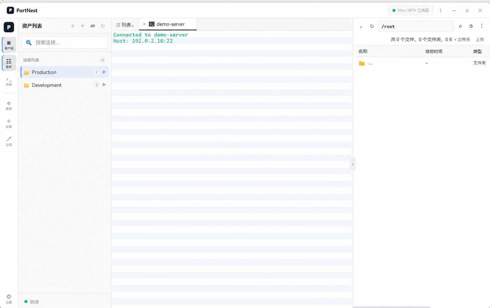

# PortNest

PortNest 是一款面向运维、开发和远程管理场景的本地优先桌面工作区。它将 SSH / SFTP、本地终端、MySQL / PostgreSQL 管理、会话资产树和多标签工作区集中在一个应用中，减少在多个工具之间来回切换。

当前版本支持 SSH、SFTP、本地命令行、MySQL、PostgreSQL 和 BYOK AI 助手。数据库连接复用同一套可扩展管理工作区，并共享统一的主题、会话标签与资产管理体验。

[下载最新版本](https://github.com/biyuzhuang/PortNest/releases/latest) · [查看 Releases](https://github.com/biyuzhuang/PortNest/releases)

## 产品界面



> 截图来自 PortNest 界面，连接名称和地址已替换为演示数据；`192.0.2.10` 属于文档示例保留地址，不对应真实服务器。

## 核心功能

### SSH 终端

- 多标签 SSH 会话，可在资产列表和已打开终端之间快速切换
- 支持密码、私钥和带口令私钥认证
- 支持浅色与深色终端配色，可跟随应用主题或使用固定配色
- 内置 VS Code、Solarized、GitHub、One、Nord、Tokyo Night、Catppuccin、Gruvbox、Monokai 和 Dracula 等多套终端主题
- 支持字体、字号、行高、字间距、纯色、渐变、本地背景图片和缓存行数设置
- 支持鼠标选中自动复制、右键粘贴和 `Ctrl+V` 粘贴
- SSH keepalive、断线识别和可选自动重连
- 支持本地端口转发、远程端口转发和动态 SOCKS 隧道管理
- 串行输出读取和输入队列，降低高延迟或大量粘贴时的会话卡顿风险

### 本地终端

- 在 PortNest 标签页内打开本机命令行
- 支持 CMD、PowerShell 等本机 Shell 配置
- 与 SSH 终端共享搜索、复制粘贴、字体和终端配色设置
- 使用独立的本地终端图标，与 SSH 和数据库会话快速区分

### SFTP 文件管理

- SSH 终端与远程文件列表同屏使用
- 浏览远程目录，并显示文件类型、大小、修改时间、权限和用户/组
- 上传、下载、新建目录、删除和重命名
- 显示隐藏文件、路径联动和显示列配置
- 文件面板支持展开、收起和拖动调整宽度
- SFTP 使用独立 SSH 连接，避免文件操作阻塞终端会话

### 资产与会话管理

- 使用文件夹和多级嵌套文件夹组织连接
- 会话可在根目录、不同文件夹之间拖动
- 文件夹与会话支持拖动排序，顺序持久化保存
- 文件夹显示自身及所有子文件夹的会话总数
- 按全部、终端和数据库类型筛选资产
- 支持搜索、右键菜单、批量选择和批量删除
- 资产大列表支持 TCP 延迟检测、刷新和延迟列显示切换

### MySQL / PostgreSQL 数据库工作区

- 浏览数据库、数据表、视图及字段结构
- SQL 编辑、执行与查询结果表格
- 数据表创建、结构预览、修改、重命名、复制、清空和删除
- 表数据分页浏览，以及记录新增、修改和删除
- 查看建表语句、索引和字段信息
- 支持 CSV 数据导入、SQL 文件导入和数据库 SQL 导出
- 数据库树、工具栏、编辑器、结果表和右键菜单完整适配明暗主题
- 数据库前端 API 与工作区按协议分派，新增数据库类型时可复用现有 UI

### AI 助手

- 支持使用自己的 API Key（BYOK）接入大模型，API Key 使用本地加密存储
- 内置 OpenAI、Claude、DeepSeek、Kimi、GLM、OpenRouter、阿里百炼、火山方舟、腾讯云混元、Ollama 和自定义供应商模板
- 支持 OpenAI Chat Completions、Anthropic Messages 和 Ollama 兼容协议
- 提供通用 Agent、终端增强 Agent 和 SQL Agent 三种工作模式
- 终端增强模式会自动附带当前会话最近 160 行终端输出作为上下文
- SQL Agent 会自动附带当前数据库、查询编辑器 SQL，以及表字段、索引和结果预览上下文
- 支持模型列表自动获取、连接测试、上下文窗口、最大输出 Token 和温度配置
- 按上下文窗口自动裁剪多轮对话历史，避免请求无限增长
- AI 回复支持流式输出和 Markdown 代码块展示
- AI 可以提出终端命令或 SQL 工具调用，但必须在界面中由用户确认后才会执行
- 工具调用会按低风险、需注意、高风险分级，删除、更新、DDL 和危险 Shell 命令会重点提示
- 高风险工具调用需要二次确认，执行结果会自动回传给模型继续分析
- 所有接受的命令和 SQL 执行都会写入本地工具审计记录，可在模型设置页查看和清空
- MCP 与自定义搜索引擎设置保留为暂不可用占位，后续版本接入

### 桌面体验与更新

- 统一的浅色、深色及跟随系统界面主题
- 设置使用单实例独立窗口，修改主题和终端外观后即时应用
- 统一 SVG 图标、状态指示灯、表单、菜单及键盘焦点样式
- 主窗口关闭前二次确认，并按顺序关闭辅助窗口和主窗口
- Windows 原生安装程序，可选择安装目录并创建桌面快捷方式
- 支持签名的应用内更新
- 设置与连接数据保存在本地
- 终端背景图片导入 IndexedDB，原始图片移动后仍可继续使用
- 敏感凭据采用本地加密存储

## 安装

前往 [GitHub Releases](https://github.com/biyuzhuang/PortNest/releases/latest) 下载：

```text
PortNest_<version>_x64-setup.exe
```

运行安装程序后可自定义安装目录。Windows WebView2 Runtime 缺失时，安装程序会按配置处理运行环境。

## 本地开发

### 环境要求

- Windows 10/11
- Node.js 18 或更高版本
- Rust stable 与 Cargo
- Microsoft WebView2 Runtime
- Tauri 2 所需的 Windows C++ 构建工具

### 启动开发环境

```powershell
git clone https://github.com/biyuzhuang/PortNest.git
cd PortNest
npm install
npm run tauri:dev
```

只启动前端页面：

```powershell
npm run dev
```

### 构建前端

```powershell
npm run typecheck
npm run build
```

检查 Rust 后端：

```powershell
cd src-tauri
cargo check
```

### 构建 Windows 安装程序

自动更新产物需要 Tauri 签名私钥。私钥必须仅保存在本地，不能提交到 Git。

```powershell
$env:CARGO_BUILD_JOBS="2"
$env:TAURI_SIGNING_PRIVATE_KEY_PATH=(Resolve-Path "src-tauri\.keys\portnest.key").Path
npm run tauri:build
```

构建结果位于：

```text
src-tauri/target/release/bundle/nsis/
```

## 技术栈

- [Tauri 2](https://tauri.app/)：桌面应用外壳与原生能力
- [SolidJS](https://www.solidjs.com/)：前端界面
- [TypeScript](https://www.typescriptlang.org/)：前端开发语言
- [xterm.js](https://xtermjs.org/)：终端渲染
- Rust `ssh2`：SSH 与 SFTP
- Rust `mysql_async`：MySQL 连接与数据操作
- Rust PostgreSQL wire protocol 客户端：PostgreSQL 连接、查询与管理操作
- Rust `reqwest`：AI 供应商 API 调用
- SQLite：本地连接、文件夹和设置数据
- IndexedDB：终端背景图片本地存储

## 安全说明

- 不要把私钥、密码、真实服务器地址或包含敏感终端输出的截图提交到仓库。
- `src-tauri/.keys/` 中的更新签名私钥必须离线备份并保持私密。
- 首次连接的 SSH 主机密钥会记录在本地；如果主机密钥发生变化，应用会拒绝连接并提示风险。
- 发布截图应使用演示数据或在提交前完成脱敏。

## Roadmap

- 继续完善 SSH 代理、高级认证和隧道诊断
- 增强大文件传输、传输队列与断点续传
- 完善终端会话恢复和诊断日志
- 后续评估更多数据库、容器和远程桌面连接能力

## 反馈

欢迎通过 [GitHub Issues](https://github.com/biyuzhuang/PortNest/issues) 提交问题和功能建议。请在日志或截图中隐藏 IP、用户名、主机名、路径和凭据信息。
