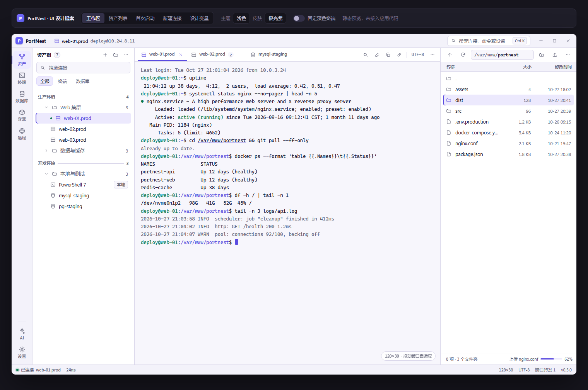
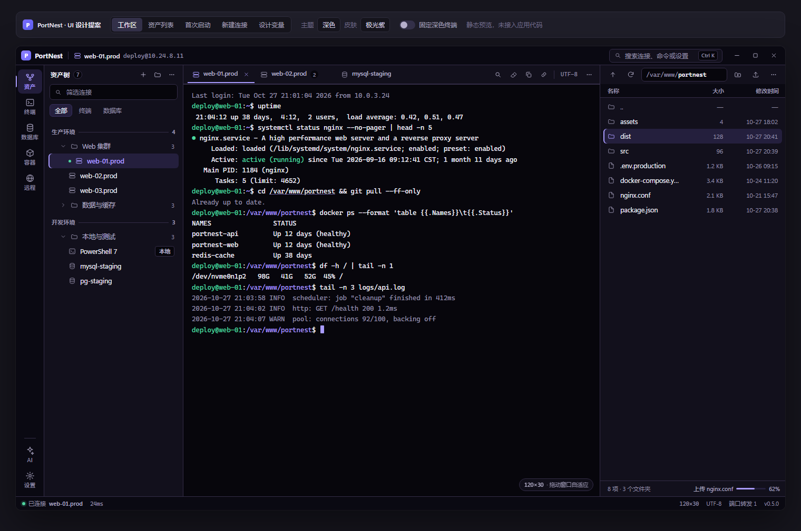
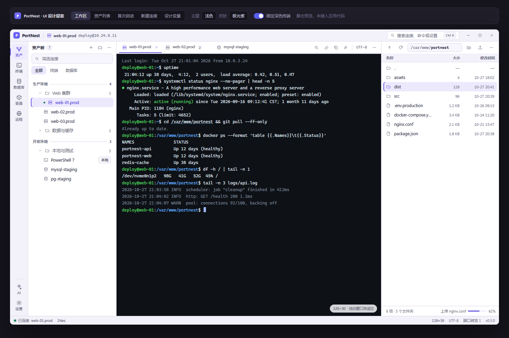
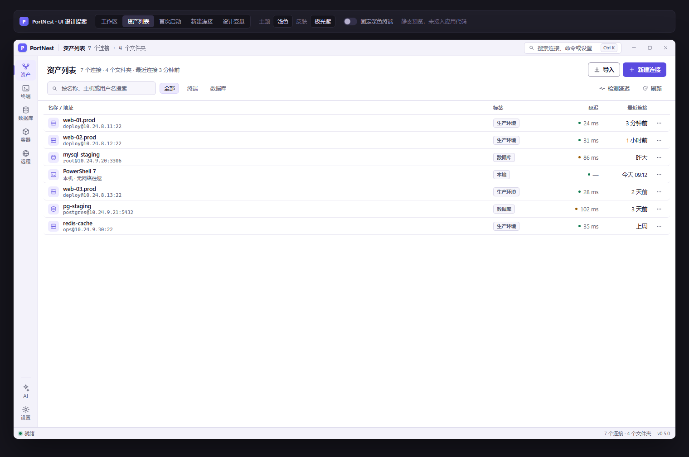
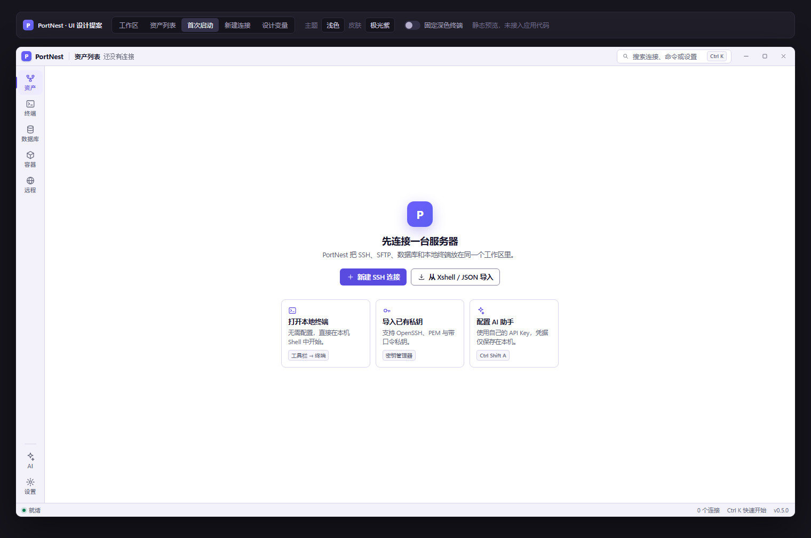
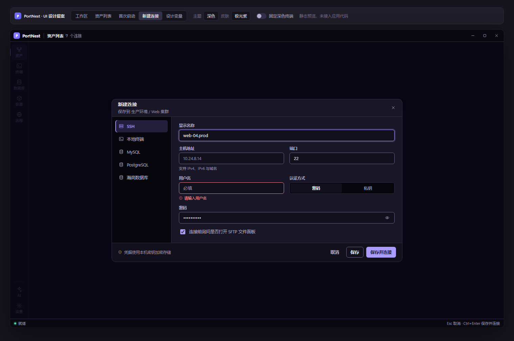

# PortNest 界面设计规范（提案 v1）

> **状态：设计提案。** 本目录只包含设计产物，`src/` 与 `src-tauri/` 一行未改。
> 所有结论都可以复查：配色由 `tools/contrast.py` 计算，数值由 `tools/audit_css.py` 统计，界面效果见 `mockup.html` 与 `shots/`。

---

## 0. 交付物

| 文件 | 内容 |
| --- | --- |
| `mockup.html` | 可交互静态预览：5 个视图、4 套皮肤、明暗两色、固定深色终端开关 |
| `shots/01–10*.png` | 上一条的渲染结果，用于评审与对比 |
| `DESIGN-SPEC.md` | 本文件：诊断、方向、变量、组件、逐屏规范、实施路径 |
| `contrast-report.md` | 176 组成对对比度实测（4 皮肤 × 2 主题 × 22 项） |
| `tools/contrast.py` | 对比度校验脚本，改色后跑一次即可知道是否达标 |
| `tools/audit_css.py` | 统计现有 CSS 的设计值离散程度 |
| `tools/audit_current.py` | 复核现有配色的对比度问题（§2.2 的证据） |
| `tools/render.ps1` | 用无头 Edge 把 mockup 渲染成 PNG |
| `tools/check_mockup.py` | 校验 mockup 的图标引用完整性 |
| `tools/fix_icons.py` | 修复 `<use>` 外层缺失 `viewBox` 的裁剪问题（已应用） |
| `tools/solve.py` | 一次性取色求解器，记录本方案色值的推导过程 |

打开方式：直接双击 `mockup.html`（无需构建、无外部依赖、可离线）。预置了 5 个视图切换，右上角可切皮肤、明暗和终端配色。

---

## 1. 我对项目的理解

**PortNest 是本地优先的桌面工作区**（Tauri 2 + SolidJS + xterm.js），把 SSH/SFTP、本地终端、MySQL/PostgreSQL/瀚高、会话资产树、AI 助手收进同一个窗口。

三个会直接影响设计的事实：

1. **终端是主舞台，不是配角。** 用户 80% 的时间盯着的是一块等宽字符网格。任何和终端抢注意力的装饰都是负债。
2. **高频、长时、键盘操作。** 运维场景下窗口会开一整天，标签可能开十几个。信息密度和「不打扰」比「惊艳」重要。
3. **离线桌面应用。** 不能引外部字体、CDN、图标字体。所有设计必须落在系统字体和本地 SVG 上——这一条否决了「换一套 Web 字体」这类常规方案。

**现有资产比想象中好：** 已经有 4 套皮肤（极光紫 / 晨雾蓝 / 暖砂 / 午夜青）× 明暗两套主题，而且是靠 `data-skin` + `data-theme` 切换的**同一份 token 契约**；已经有统一的 24×24 `Icon.tsx`（stroke 1.8，全部 `aria-hidden`）；已经有语义变量（`--workspace-*`、`--ui-*`）。这是一次**收敛**，不是重写。

问题不在「没有设计系统」，而在**设计系统被三层 CSS 反复覆盖后失去了约束力**。

---

## 2. 现状诊断

先把可测量的问题列出来。以下数字都由脚本统计或计算得出，不是主观感受。

### 2.1 设计值失控

| 维度 | 现状 | 后果 |
| --- | --- | --- |
| CSS 规模 | 19 个文件，**17,893 行** | `App.css` 5432 行 + `visual-refresh.css` 1607 行 + `Surfaces.css` 1151 行 + `Themes.css` 1629 行，四层互相覆盖，后来者靠 `!important` 取胜（`Themes.css` 里已有大量 `!important`） |
| 圆角 | **19 种取值**（1/2/3/4/5/6/7/8/9/10/11/12/13/14/15/16/20/22/999 px） | 相邻控件半径不一样，界面像拼装的 |
| 字号 | **27 种取值**（8/8.5/9/9.5/10/…/34 px） | 光是 8–9.5px 就出现 **88 次**；中文在这个尺寸下字形糊成一团 |
| 高度 | **56 种取值** | 工具栏、行、按钮高度对不齐，垂直节奏消失 |

`8–9.5px` 的 88 处集中在 `AIAssistant.css`、`SettingsModal.css`、`App.css` 的说明文字上。拉丁字母在 9px 尚可辨认，**中文此时已不可读**。

### 2.2 对比度：三类明确不达标

用 WCAG 公式实测现有配色：

| 场景 | 实测 | 要求 | 位置 |
| --- | --- | --- | --- |
| 浅色 `--text-muted #9495a8` 用于白底 | **2.95:1** | ≥ 4.5:1 | `Themes.css` 各皮肤的 muted |
| 深色主按钮「白字 / 极光紫渐变起点 `#8f80ff`」 | **3.13:1** | ≥ 4.5:1 | `Themes.css:863` 统一写死 `color:#fff` |
| 深色主按钮「白字 / 午夜青 `#2dd4bf`」 | **1.86:1** | ≥ 4.5:1 | 同上，最差 |
| 深色主按钮「白字 / 晨雾蓝 `#5aa2ff`」 | **2.61:1** | ≥ 4.5:1 | 同上 |
| 输入框边框 `#e8e6f4` / 白 | **1.23:1** | ≥ 3:1（1.4.11） | `Themes.css` `--border` |

根因有两个，都可修：

- **弱化文本被当成「灰」而不是「可读文本」**——muted 本意是降权，但它承载了时间戳、计数、说明这些真实信息。
- **深色皮肤下强调色是亮色，却统一配白字**。亮底配白字必然不达标。正确做法是深色皮肤的主按钮改用**深墨色文字**（`--on-accent`），而不是把强调色压暗——后者会让品牌色在深色下失去活力。

### 2.3 垂直空间被 chrome 吃掉

| 区域 | 高度 | 来源 |
| --- | --- | --- |
| 标题栏 | 40px | `App.css:1214` |
| 标签栏 | 48px（`padding: 8px 16px`） | `App.css:1556` |
| 会话操作栏 | 34px | `App.css:2609` |
| **主区顶部合计** | **122px** | 900px 高窗口里占 **13.6%** |

标签栏和操作栏是**两个连续的水平条**，中间还隔着一条 1px 分割线——它们在视觉上是同一件事：当前会话的上下文与操作。分成两行纯属历史原因。

另外，全局状态信息目前只有一个出口：侧栏底部的 `.sidebar-footer`（`Sidebar.tsx:591`），它只占侧栏宽度，终端区和文件面板下方是空的。而标题栏右侧又有一个「SSH / SFTP 工作区」徽章在重复表达连接状态。

### 2.4 选中态有四套语言

| 位置 | 现写法 |
| --- | --- |
| 左侧导轨 | `inset 2px 0` 左侧色条 + 背景 |
| 资产树行 | 半透明填充 + 左侧色条 + 边框 |
| 会话标签 | 底部 2px `border-color: var(--accent)` + 文字变强调色 |
| 文件行 | 左侧色条 + 填充 |

同一个概念（「这个是被选中的」）用四种画法，用户每次都要重新学。这不是美学问题，是**学习成本**问题。

### 2.5 层级靠描边，不靠表面

截图里几乎每个区域的交界都是一条 1px 线，而所有面板的底色又几乎一样（白 / 近白）。结果是：**眼睛看到的是一张网格，而不是一个有纵深的工作台**。左栏、终端、文件面板三者地位相同，无法判断「工作发生在哪里」。

### 2.6 装饰与信息的比例失衡

终端条纹背景（`App.css:5374`，`rgba(127,140,160,.10)` 整行铺满）默认是关闭的（`themeStore.ts:357`）。**决策已定：保留该选项，默认关闭**，因此它不是问题；只是 README 主图恰好是开启状态，评审时容易被误认为默认样式。若要进一步优化，见 §14 备注。

同样，标题栏的「SSH / SFTP 工作区」徽章与侧栏底部条里的「就绪 / 连接」指示**重复表达同一件事**，两处都带状态点，而且都不在用户视线中心。

### 2.7 颜色的职责过多

蓝、青、紫、琥珀、绿五种颜色同时出现在 chrome 里（品牌渐变、标签、状态点、协议图标）。当强调色同时表示「品牌」「可点击」「选中」「在线」「链接」时，**它就不再是强调色了**。

---

## 3. 设计方向：静默终端（Quiet Terminal）

一句话：**让终端成为屏幕上唯一「响」的东西，其余一切退成安静的框架。**

四条原则，按优先级排序。冲突时，上面的赢。

### 原则 1 · 一个焦点平面

任何一个屏幕只允许有一个高对比、高饱和或高密度的区域。工作区里它是终端；连接表单里它是表单主体；资产列表里它是数据表。
**推论：** chrome 不使用渐变、不使用大面积强调色、不使用彩色描边。

### 原则 2 · 表面优先于描边

用「背景层级」区分区域，描边只在**表面确实切换**的地方保留一条发丝线。层级共 5 层：

```
外壳 shell      —— 标题栏、导轨、状态栏（最外层）
基础 base       —— 侧栏、文件面板（默认工作表面）
抬升 raised     —— 菜单、弹窗、卡片（浮在 base 之上）
凹陷 sunken     —— 终端、搜索框、输入框（沉下去）
选中 selected   —— 行/标签的选中填充
```

**推论：** 面板之间去掉多余边框；卡片不再「白底 + 边框 + 阴影」三件套，改为「白底 + 阴影」或「浅底 + 发丝线」。

### 原则 3 · 一种选中语言

全应用只有一个规则：

> **选中 = 强调色淡填充 + 沿「阅读起点」方向的 2px 强调色实心条。**

「阅读起点」随方向变化：竖排列表取左缘，横排标签取底缘，导轨取左缘。规则只有一个，表现随方向自然变化。

### 原则 4 · 颜色只表达状态

| 颜色 | 唯一职责 |
| --- | --- |
| 强调色（每皮肤一个） | 主操作、选中、聚焦、链接 |
| 绿 | 在线 / 成功 |
| 琥珀 | 警告 / 降级 |
| 红 | 错误 / 破坏性操作 |
| 协议色（SSH / 本地 / MySQL / PG） | **仅限图标与徽标**，不进入文字、不进入背景 |

**推论：** 品牌渐变只保留在 logo 方块上。主按钮用**纯强调色实心**，不用渐变——渐变会让按钮在深色皮肤下更亮、更难保证对比度（这正是 2.2 里 1.86:1 的成因）。

### 明确不做的事

- 不引进第三方 UI 框架（会与现有 17k 行 CSS 打架，收益低）
- 不引进在线字体（离线应用，且中文字体包体积不可接受）
- 不把界面改成 VS Code 那种「纯工具、零装饰」——PortNest 是给个人用的，保留一点品牌温度
- 不为了「现代」加毛玻璃、大圆角、渐变边框

---

## 4. 布局

### 4.1 区域与尺寸

| 区域 | 尺寸 | 背景层 | 说明 |
| --- | --- | --- | --- |
| 标题栏 | **36px** | shell | 品牌 · 当前连接面包屑 · 搜索入口 · 窗口按钮 |
| 模块导轨 | **54px** | shell | 图标 18 + 文字 11，6 + 2 项 |
| 资产树 | **264px** | base | 可拖动，最窄 200，最宽 420 |
| 会话头 | **36px** | base | 标签 + 会话操作**合并为一行** |
| 终端 | 自适应 | sunken | 工作重点，唯一的高密度区域 |
| 文件面板 | **352px** | base | 可拖动，最窄 280，最宽 560 |
| 状态栏 | **26px** | shell | 全局唯一的状态出口 |

### 4.2 垂直预算

| | 现状 | 提案 | 差 |
| --- | --- | --- | --- |
| 标题栏 | 40 | 36 | −4 |
| 标签栏 + 操作栏 | 48 + 34 = 82 | 36（合并为会话头） | −46 |
| 主区顶部合计 | **122** | **72** | **−50** |
| 全局状态栏 | 0（信息挤在侧栏底条里） | 26 | +26 |
| **终端净得** | — | **+24px** | — |

说实话：**净增只有 24px**（约 1.2 行），因为同时新增了一条全宽状态栏——**这条状态栏已确认要做**。真正的收益不在高度，而在两件事：

1. 顶部少一条横杠，标签和操作回到同一行，视觉上「一层 chrome」代替「两层」；
2. 状态信息从侧栏底条里解放出来，成为贯穿全宽的稳定锚点——编码、终端尺寸、转发数、传输进度终于有地方放。

水平方向：导轨 48→54（+6，换来可读的中文标签），资产树 286→264（−22），文件面板 390→352（−38），终端净增 **54px**。

### 4.3 断点行为

| 窗口宽度 | 行为 |
| --- | --- |
| ≥ 1280 | 完整四栏 |
| 1024–1279 | 资产树 240，文件面板可折叠为浮动层 |
| 960–1023 | 资产树折叠为导轨；文件面板默认隐藏，通过标题栏按钮唤出 |
| < 960 | 只保留导轨 + 主区（与现有 `keepTerminalUsable` 行为一致） |

最低窗口 960×600 保持不变。

---

## 5. 设计变量

### 5.1 三层结构

```
原语 primitive   ── 每皮肤一套原始色值，只在本文件出现
      ↓
语义 semantic    ── surface / text / line / accent / state，界面只认这一层
      ↓
组件 component   ── 高度、圆角、间距、动效时长，界面只认这一层
```

现有代码里 `--bg-primary`、`--workspace-surface`、`--ui-surface` 三套名字指向同一个概念，这是历史包袱。提案保留旧名作为**别名**（保证不改组件就能先换皮），新代码只写新名。

### 5.2 语义变量表

| 组 | 变量 | 用途 |
| --- | --- | --- |
| 表面 | `--surface-shell` `--surface-base` `--surface-raised` `--surface-sunken` `--surface-selected` `--surface-hover` | 5 层纵深 + 悬停 |
| 文本 | `--text-1` `--text-2` `--text-3` `--on-accent` | 主 / 次 / 弱 / 强调色上的文字 |
| 强调 | `--accent` `--accent-soft` `--accent-line` | 实心、淡底、描边 |
| 线条 | `--line` `--line-strong` `--line-control` | 发丝 / 分隔 / **控件边界** |
| 状态 | `--success` `--warning` `--danger` `--info` | 仅状态 |
| 终端 | `--term-bg` `--term-fg` `--term-dim` `--term-green/blue/amber/red` | 由终端主题预设映射 |

`--line-control` 是这次新加的：**只有它需要满足 3:1**。发丝线和分隔线是装饰，不承载信息，强制 3:1 会让界面变得又硬又重——这是很多设计系统做错的地方。

### 5.3 对比度结论

`tools/contrast.py` 对 **4 皮肤 × 2 主题 × 22 项 = 176 组**配对做了校验，**全部通过**：

- 正文 / 主文本 ≥ **7:1**（AAA）
- 次要文本、强调色、状态色 ≥ **4.5:1**（AA）
- 表单控件边界 ≥ **3:1**（1.4.11）
- 面板分隔 ≥ **1.45:1**、装饰发丝线 ≥ **1.18:1**（设计下限，保证明暗两套都看得见）

完整名单见 `contrast-report.md`。改任何颜色后跑一次脚本即可，不需要人工数。

### 5.4 组件变量

| 类别 | 取值 |
| --- | --- |
| 圆角 | `--r-xs 4`（徽标/键帽） · `--r-sm 6`（行/按钮/输入） · `--r-md 8`（卡片/菜单/面板） · `--r-lg 12`（弹窗/大面板） · `--r-full` |
| 高度 | 行 28 · 控件 32 · 页头 36 · 标签 32 · 状态栏 26 · 导轨项 46 |
| 间距 | 2 / 4 / 6 / 8 / 12 / 16 / 20 / 24 / 32 |
| 动效 | 见 §10 |

**只有 4 个圆角、6 个高度。** 从 19 种和 56 种收敛到 4 和 6，这是「看起来专业」最直接的来源。

---

## 6. 排版

### 6.1 字体栈（离线、系统字体）

```css
--font-ui:   -apple-system, BlinkMacSystemFont, "Segoe UI Variable Text", "Segoe UI",
             "PingFang SC", "Microsoft YaHei UI", "Microsoft YaHei", sans-serif;
--font-mono: "Cascadia Mono", "JetBrains Mono", "Cascadia Code", Consolas, monospace;
```

不引入 Google Fonts。中文回退链里 `Segoe UI Variable` → `PingFang SC` → `Microsoft YaHei UI` 覆盖 Windows/macOS，Windows 上用 Variable 版本在 13px 下字形更清晰。

> 说明：`ui-ux-pro-max` 的字体配对库对中文没有可用推荐（返回的是 Varela Round / Poppins 这类纯拉丁方案），因此这里不采用数据集结论，改用上面这套**经过 Windows 中文渲染验证的系统栈**。

### 6.2 字号阶梯（7 档，不再增加）

| 级别 | 字号 / 字重 | 用途 | 中文最低要求 |
| --- | --- | --- | --- |
| 弹窗标题 | 20 / 650 | 对话框主标题 | — |
| 页面标题 | 16 / 650 | 资产列表、设置分组 | — |
| 面板标题 | 14 / 650 | 侧栏标题、卡片标题 | — |
| 正文 | 13 / 400–550 | 默认 UI 文本、表单值 | **13px 是中文正文下限** |
| 次级 | 12 / 400 | 说明、副标题、列内容 | — |
| 元信息 | 11 / 600 | 列头、时间戳、计数（加 `.04em` 字距） | **11px 是中文最小可用值** |
| 终端 | 12.5 / 400 等宽 | 终端内容（用户可调） | — |

**红线：中文不得低于 11px。** 现有代码里 88 处 8–9.5px 的中文必须上调或删除——删掉比上调更好，因为那些信息大多是「设计上想秀、用户不会读」的装饰性小字。

### 6.3 等宽字体的使用边界

等宽**只用于**：主机地址、路径、端口、终端内容、编码名、尺寸数字（`120×30`）。
**不用于**：按钮、标签、菜单、标题。

### 6.4 数字对齐

所有数字列（延迟、大小、时间、计数、百分比）加 `font-variant-numeric: tabular-nums`。现有效果里延迟列在跳动时宽度会变，就是这个原因。

---

## 7. 图标

**继续用现有的 `Icon.tsx`**，不换 Phosphor。

理由：`Icon.tsx` 已经是统一的 24×24 / stroke 1.8 / round 端点 / 全部 `aria-hidden` 的自绘集合，体积极小、完全离线。换成 `@phosphor-icons/react` 会引入约 2MB 依赖、打乱线宽一致性，收益为零。

（`ui-ux-pro-max` 默认推荐 Phosphor，这里基于「离线桌面 + 已有自绘集合」明确不采用。）

需要新增的补足项：

- **尺寸 token**：`--icon-sm 14` · `--icon-md 16` · `--icon-lg 18`，按容器高度选，不随手写 20 / 24 / 28。
- **线宽**：全应用 1.8 不变；14px 时仍用 1.8（缩放 viewBox，不缩放 stroke），保证小图标不发虚。
- **语义**：与文字并排的图标 `aria-hidden`（现有已满足）；**独立作为按钮时，按钮必须有 `aria-label`**。当前 `App.tsx:1019` 的「⋯」按钮既无 `aria-label` 也无 `title`，需要补。
- **填充/描边纪律**：同一层级只用一种。状态点用实心圆，功能图标用描边，不混。

> **实现陷阱（本轮 mockup 已踩过）**：用 `<symbol>` / `<defs> + <use>` 复用图标时，**承载 `<use>` 的外层 `<svg>` 必须带 `viewBox="0 0 24 24"`**，否则 24×24 的图形会被裁剪到 14×14 的视口里，只显示左上角一小块。SolidJS 里如果封装成组件，`viewBox` 应当写死而不是从 props 传，避免漏传。`Icon.tsx` 目前是内联路径、不受影响，但重构时必须注意。

---

## 8. 组件规范

### 8.1 选中态（唯一规则）

```css
.selected {
  background: var(--surface-selected);
  box-shadow: inset 2px 0 0 var(--accent);   /* 竖排 */
}
.tab[aria-selected="true"] {
  background: var(--surface-base);
  box-shadow: inset 0 -2px 0 var(--accent);  /* 横排 */
}
```

选中行内文字变为 `--accent`（已验证与 `--surface-selected` ≥ 4.5:1）。

### 8.2 行

| 属性 | 规格 |
| --- | --- |
| 高度 | 28px（树、文件、菜单项） / 38px（资产表） |
| 内边距 | 8px，圆角 6px |
| 悬停 | `--surface-hover`，**不做位移动画**（位移会造成周边抖动） |
| 图标 | 14px，`--text-3` |
| 主文字 | 12.5px `--text-1`，单行省略 |
| 元信息 | 11.5px `--text-3`，`tabular-nums`，右对齐 |

### 8.3 标签页

| 属性 | 规格 |
| --- | --- |
| 高度 | 32px，最大宽 208px |
| 内容 | 协议图标 14 · 名称 12.5 · 序号徽标（同连接多开时） · 关闭按钮 18（悬停/选中时显现） |
| 选中 | `base` 底 + 底部 2px 强调色 + 文字 550 |
| 未选中 | 透明底，`--text-2` |
| 溢出 | 横向滚动，**不做折行**；滚动条隐藏但保留滚轮与 `Ctrl+Tab` |

### 8.4 按钮

| 类型 | 底色 | 文字 | 边框 | 高度 |
| --- | --- | --- | --- | --- |
| 主 | `--accent` 实心 | `--on-accent` | 无 | 32 |
| 次 | `--surface-base` | `--text-1` | `--line-control` | 32 |
| 文字 | 透明 | `--text-2` | 无 | 32 |
| 危险 | 透明 | `--danger` | 无（悬停时淡红底） | 32 |
| 图标 | 透明 | `--text-2` | 无 | 28×28，圆角 6 |

主按钮**用纯色不用渐变**，且必须使用 `--on-accent`（深色皮肤是深墨色）——这是 §2.2 那个 1.86:1 的修复点。

### 8.5 输入

| 属性 | 规格 |
| --- | --- |
| 高度 | 34px（表单） / 30px（工具条内） / 26px（标题栏胶囊） |
| 边框 | 1px `--line-control`（≥ 3:1） |
| 聚焦 | 边框转 `--accent`，外加 3px `color-mix(accent 20%)` 光晕 |
| 错误 | 边框 `--danger`，下方 11px 红色说明 + 警示图标 |
| 标签 | 11.5px / 600，`--text-2`，位于输入上方 5px |

### 8.6 菜单 / 弹窗

| | 菜单 | 弹窗 |
| --- | --- | --- |
| 背景 | `--surface-raised` | `--surface-raised` |
| 边框 | `--line` | `--line` |
| 圆角 | 8 | 12 |
| 阴影 | `0 12px 32px rgba(16,14,32,.16)` | `0 32px 80px rgba(16,14,32,.28)` |
| 遮罩 | — | `surface-shell 55% + rgba(12,10,24,.62)` |

菜单项 28px 高，图标 14 + 主文字 12.5 + 右侧快捷键 11px `--text-3`。

### 8.7 状态指示

**状态点 + 文字，永远成对出现**，不单靠颜色：

- 在线：6px 绿点 + 光晕 + 文字
- 警告：琥珀点 + 文字
- 断开：空心点 + 文字

单一状态出口在**底部状态栏**，标题栏不再重复。

### 8.8 空状态

三段式：44px 图标块（`--accent-soft` 底）→ 14px 标题 → 12px 说明 → 一个次按钮。
文案避免「暂无数据」，改为**说明下一步**：「换个关键词，或清除筛选条件查看全部 7 个连接。」

### 8.9 首次启动

首次启动不是「空状态」，是**引导**：48px 品牌块 → 18px 标题 → 12.5px 一句定位 → 主/次两个动作 → 3 张并列卡片（本地终端 / 导入私钥 / 配置 AI）。见 `shots/07-empty-light.png`。

---

## 9. 逐屏设计

### 9.1 工作区（主界面）





**标题栏（36px）**
品牌方块 19px + 字标；竖分隔；协议图标 + 连接名 + `host:port`（等宽 11.5px，`--text-3`）；右侧是搜索胶囊（26px，含 `Ctrl K` 键帽）与窗口按钮（34×30）。
**移除了「SSH / SFTP 工作区」徽章**——它和状态栏重复。

**模块导轨（54px）**
图标 18 + 文字 11 / 500，项高 46。当前项 = `--accent-soft` 底 + 左缘 2px 强调色 + 强调色文字。
导轨宽度从 48 提到 54，是为了让「数据库」「容器」这些三字标签不再挤压换行。

**资产树（264px）**
页头 36（标题 12/650 + 计数胶囊 + 3 个 26px 图标按钮）→ 搜索 30 → 筛选 chip 24 → 行 28。
文件夹用展开箭头（12px，`ChevronRight` 旋 90°）+ 文件夹图标；分组标题用 10.5 / 650 / `.06em` 大写风格 + 延伸发丝线 + 计数。
正在连接的行带 5px 绿点，不改变整行底色（**状态不污染表面**）。

**会话头（36px，合并后）**
左：标签组；右：查找、清屏、复制会话信息、端口转发、分隔、编码胶囊、更多。
原来的「列表」标签改为导轨的「资产」项承载，标签区只放真实会话。

**终端**
无条纹。内边距 12/16。等宽 12.5 / 行高 1.62。右下角浮动 24px 胶囊显示 `120×30`（拖动窗口时出现，2 秒后淡出）。
终端背景用 `--surface-sunken`：浅色下是极浅的冷灰，深色下是比面板更深的「井」——**这是「工作发生在这里」的唯一提示**，不需要边框。

**文件面板（352px）**
路径栏 36（返回 / 刷新 / 路径框 / 新建目录 / 上传 / 更多）→ 列头 26 → 行 28 → 页脚 30。
路径框内**祖先路径用 `--text-3`，当前目录用 `--text-1`**，一眼看出层级。
页脚左：`8 项 · 3 个文件夹`；右：传输进度（56×3 进度条 + 百分比）。

**状态栏（26px）**
左：绿点 + `已连接 web-01.prod`；右：`24ms` · `120×30` · `UTF-8` · `端口转发 1` · `v0.5.0`。数字全部 `tabular-nums` + 等宽。

**关于终端配色（已定）**：**跟随主题**——浅色界面下终端就是浅色，深色界面下是深色。固定深色终端仍然保留为设置项，`shots/03` 只演示这个选项，不作为默认。

这意味着浅色界面下终端与面板同属浅色系，**层级必须靠「凹陷背景（`--surface-sunken`）+ 顶部 1px 发丝线」承担**，不能靠色相反差。设计上这是成立的：终端底色比面板暗一档，加上它是屏幕上唯一的高密度等宽文本区，焦点自然落在这里。



### 9.2 资产列表



页头（标题 16/650 + 统计 + 导入/新建连接）→ 工具行（搜索 240 + 筛选 chip + 检测延迟/刷新）→ 表头 30（sticky）→ 行 38。
列：`1fr | 132 | 88 | 96 | 28`（名称地址 / 标签 / 延迟 / 最近连接 / 操作）。
名称列是两行结构：24px 图标块（`--accent-soft` 底 + 强调色图标）+ 名称 12.5/550 + `host` 等宽 11.5/`--text-3`。
延迟用「点 + 数字」右对齐；> 80ms 变琥珀。标签是 20px 高的浅底胶囊，不用彩色填充。

### 9.3 首次启动



居中引导，宽度 520，不铺满。三张卡片直接给出「不用配连接也能开始」的路径——本地终端和 AI 助手是 PortNest 相对同类产品的差异点，值得在第一步就露出。

### 9.4 新建连接



弹窗 860 宽，头 52，脚 56。左侧协议栏 176（5 个协议 + 当前项左缘强调条），右侧两列表单（列间距 16 / 行间距 14）。
表单字段一律 34px 高、1px `--line-control` 边框；聚焦显示 3px 光晕；错误同时用**红色边框 + 图标 + 文字**三重编码（不只靠颜色）。
底部左侧是安全说明（盾牌图标 + 11.5px），右侧 取消 / 保存 / 保存并连接。
**两列只放短字段**（端口、用户名、认证方式），主机、名称、密码独占整行。

### 9.5 设置窗口

沿用同一套变量，不另立风格。左侧导航 200px（选中态同 §8.1 竖排规则），右侧内容区最大宽 720 居中（避免超宽行）。
分组卡片 = `--surface-base` + 1px `--line` + 圆角 8，**不再用「白底 + 边框 + 大阴影」三件套**。分组标题 14/650，说明文字 11.5/`--text-3`。

### 9.6 AI 助手侧栏

右侧 380px 停靠（与文件面板同宽级别），头部 44 含模式切换（通用 / 终端增强 / SQL）。用户气泡用 `--accent-soft`，助手气泡用 `--surface-sunken`，不画左右箭头。
工具调用卡片必须有**风险等级色条**（低=绿 / 中=琥珀 / 高=红）与二次确认，沿用现有分级逻辑。
代码块用等宽 12 + `--surface-sunken` 底 + 顶部 1px 线，不加圆角阴影堆叠。

### 9.7 命令广播

写作窗格保持现有的「文档流 + 可拖动分界条」结构（不浮层、不遮终端），仅统一到新变量：分界条 4px 命中区、悬停显示 `col-resize`；两个功能区导航改为 32px 高的分段控件。

### 9.8 数据库工作区

对象树 240 + SQL 编辑器 + 结果表。结果表沿用资产表的行规格（38px、`tabular-nums`、右对齐数字）。SQL 关键字着色只使用 `--accent` 与状态色，不引入第五套语法色板。

### 9.9 传输中心

列表行高 28，进度用 3px 细条（不用圆环）。失败行左侧 2px `--danger` 竖条，重试按钮为文字按钮，避免每行两个实心按钮。

---

## 10. 交互与动效

### 10.1 时长与缓动

| 场景 | 时长 | 缓动 |
| --- | --- | --- |
| 按下反馈 | 90ms | `ease-out` |
| 悬停变色 | 120ms | `ease-out` |
| 面板/标签切换 | 160ms | `cubic-bezier(.2,.7,.3,1)` |
| 菜单展开 | 140ms 进入 / 90ms 退出 | 同上 |
| 弹窗 | 220ms 进入 / 140ms 退出 | 同上 |

**退出永远比进入快**。菜单、弹窗、抽屉遵守同一条。

### 10.2 禁止

- 悬停时 `translateY(-1px)`：会让周边内容抖动（现有 `Themes.css:894` 主按钮就在这么做）
- 超过 240ms 的界面过渡
- 视差、自动轮播、循环呼吸动画（终端光标闪烁除外）

### 10.3 减少动效

```css
@media (prefers-reduced-motion: reduce) {
  *, *::before, *::after { animation-duration: .01ms !important; transition-duration: .01ms !important; }
}
```

终端光标在 reduced-motion 下改为常亮（不闪烁）。

### 10.4 键盘地图

| 快捷键 | 动作 | 现状 |
| --- | --- | --- |
| `Ctrl K` | 快速切换 / 搜索 | 已有 |
| `Ctrl N` | 新建连接 | 已有 |
| `Ctrl W` | 关闭当前标签 | 已有 |
| `Ctrl Shift T` | 恢复关闭的标签 | 已有 |
| `Ctrl Tab` | 切换标签 | 已有 |
| `Ctrl Shift A` | 打开 AI 助手 | 已有 |
| `Ctrl B` | 折叠资产树 | **新增** |
| `Ctrl J` | 折叠文件面板 | **新增** |
| `F6` | 在导轨 / 树 / 终端 / 面板间循环焦点 | **新增** |
| `Ctrl F` | 终端内查找 | 已有（搜索条） |
| `Esc` | 关闭最上层浮层 | 已有（部分） |

`F6` 是这类四栏工作区的关键补充——没有它，键盘用户无法在不碰鼠标的情况下到达文件面板。

---

## 11. 无障碍

### 11.1 目标尺寸

技能清单里的 44pt / 48dp 是**移动端**规则，桌面鼠标场景不适用。本方案采用：

| 类型 | 最小视觉尺寸 | 最小命中区 |
| --- | --- | --- |
| 图标按钮 | 28×28 | 32×32 |
| 主/次按钮 | 32 高 | 32 高 |
| 列表行 | 28 高 | 整行可点 |
| 相邻可点元素间距 | — | ≥ 4px |

### 11.2 焦点

- 全应用统一 `:focus-visible`：2px `--accent` + 2px offset
- `outline: none` 必须同时给出替代焦点样式。现有 `Themes.css:927–934` 用 `box-shadow` 替代，做法是对的，需要全量保持一致
- 焦点必须可见：浮层打开时，焦点进入浮层并在关闭后回到触发元素

### 11.3 对比度

见 §5.3 与 `contrast-report.md`。**深色主题必须单独验证**，不能从浅色的结论推断——本次 176 组里深色占了 88 组，全部单独计算。

### 11.4 不靠颜色传达

状态点必配文字；错误必配图标 + 文字；选中态除了填充还有 2px 实心条（形状差异）。

### 11.5 语义与朗读

- 标签组 `role="tablist"` / `role="tab"` / `aria-selected`
- 资产树 `role="tree"` + `aria-expanded`（文件夹）
- 图标按钮必须有 `aria-label`（当前「⋯」按钮缺失）
- 装饰性图标 `aria-hidden="true"`（`Icon.tsx` 已默认满足）

---

## 12. 实施路径

**五个阶段都已确认在范围内**，但顺序不可颠倒：P4 依赖 P0 的 token 层，且必须最后做。本次只产出设计，代码仍未改动。

| 阶段 | 内容 | 影响文件 | 风险 |
| --- | --- | --- | --- |
| **P0 token 层** | 新增 `src/styles/tokens.css`；把 4 皮肤映射到新语义键；旧变量名保留为别名 | 新增 1 文件，`Themes.css` 顶部改 import | 低：观感几乎不变，可单独合入 |
| **P1 外壳** | 标题栏 36、导轨 54、标签/操作栏合并为 36、状态栏 26 | `App.tsx`（结构）、`App.css`（shell 段）、`visual-refresh.css` | 中：涉及 JSX 结构调整 |
| **P2 列表** | 树 / 文件面板 / 资产表统一到行规格与选中态 | `Sidebar.tsx` `RightPanel.tsx` `AssetList.tsx` 及对应 CSS | 中 |
| **P3 表单** | 输入 34px + `--line-control` + 错误三重编码；主按钮改 `--on-accent` | 各表单组件、`Themes.css` 第 3 节 | 低，但影响面广 |
| **P4 收拢** | 合并重叠 CSS 层，`@layer` 定层序，去掉 `!important` | 见 §12.1 | 高：必须逐屏回归 |

**建议先做 P0 + P1**：观感变化最大、风险最可控。

### 12.1 P4 · CSS 收拢的执行方案

P4 不产生任何视觉变化，它的价值是让前面三步**不反弹**。做法：

1. **先量死代码。** 用脚本统计「同选择器 + 同属性」被后层覆盖的次数——被完全覆盖的规则都是死代码，删掉不影响渲染。`design/tools/audit_css.py` 可以扩成 `--duplicates` 模式，先出一份清单再动手。
2. **建立层序，从根上停战。** 用 CSS `@layer` 显式声明：

   ```css
   @layer tokens, base, layout, components, skins;
   ```

   现有四层（`App.css` → `visual-refresh.css` → `Surfaces.css` → `Themes.css`）的关系是**靠书写顺序和特异性**维持的，任何人加一条规则都可能意外覆盖别处。`@layer` 之后，层内谁赢由层序决定，不再需要 `!important`。
3. **合并目标**（19 → 6 个文件）：

   | 目标文件 | 来源 |
   | --- | --- |
   | `tokens.css` | `Themes.css` 的变量段（按皮肤拆分） |
   | `base.css` | `App.css` 的基础/重置/排版段 |
   | `layout.css` | `App.css` 的 shell 段 + `visual-refresh.css` 的布局部分 |
   | `components.css` | 各组件 CSS 合并（AI/设置/文件/数据库等按块保留） |
   | `surfaces.css` | `Surfaces.css` 精简后 |
   | `skins.css` | `Themes.css` 的皮肤差异（**只允许改颜色变量，禁止改尺寸**） |

4. **`!important` 归零。** 现有 `Themes.css` 里大量 `!important` 是「层序失控」的产物，不是需求。每条都要记成一条优先级债，用层序或更具体的选择器偿还。
5. **回归靠快照。** `design/mockup.html` 覆盖了主要形态，再补 4 张改前截图（浅/深 × 工作区/资产列表），每合并一个文件跑一次 `tools/render.ps1` 对照。P4 **不改任何 JSX**，出问题按文件回滚。

预期结果（估算，不是承诺）：19 个文件 → 6 个，17,893 行 → 约 9,000 行，`!important` 归零。

过程中随时可跑：

```powershell
python design/tools/contrast.py     # 配色是否仍达标
pwsh   design/tools/render.ps1      # 重新渲染 mockup 对照
```

---

## 13. 验收清单

**视觉**
- [ ] 圆角取值不超过 4 种
- [ ] 字号取值不超过 7 档，且中文最小 11px
- [ ] 控件高度取值不超过 6 种
- [ ] 全应用只有一个选中态规则
- [ ] chrome 区域无渐变、无大面积强调色
- [ ] 终端条纹默认关闭
- [ ] 任意复用图标的 `<svg>` 都带 `viewBox`，图标完整不裁切

**对比度**
- [ ] `contrast.py` 全绿（176 组）
- [ ] 深色主题单独验证过，不是从浅色推断
- [ ] 主按钮文字在四皮肤深色下均 ≥ 4.5:1
- [ ] 表单边框 ≥ 3:1

**布局**
- [ ] 900px 高窗口下 chrome ≤ 100px
- [ ] 960 / 1024 / 1280 / 1600 四个宽度无溢出、无遮挡
- [ ] 四栏在 1280 宽下终端可用宽度 ≥ 500px

**交互**
- [ ] 所有可点元素有 `:focus-visible`
- [ ] 悬停不产生布局位移
- [ ] `prefers-reduced-motion` 下无过渡
- [ ] 所有图标按钮有 `aria-label`
- [ ] 全部操作可纯键盘完成（含 `F6` 区域循环）

---

## 14. 设计决策与待决项

### 14.1 已确认（2026-10-27）

| # | 决策 | 对设计的影响 | 落在哪 |
| --- | --- | --- | --- |
| 1 | 浅色界面下**终端也是浅色**（跟随主题） | 焦点平面改由「凹陷背景 + 顶部发丝线」承担，不能靠色相反差；固定深色终端降级为可选项 | §9.1，mockup 默认即此 |
| 2 | 终端条纹**保留，默认关闭** | 不删功能、不改默认值；条纹不再是问题项 | §2.6 |
| 3 | **需要**全宽状态栏 | 26px 贯穿底部，作为唯一状态出口；侧栏底部条的内容迁入这里 | §4.2、§9.1 |
| 4 | **做** P4 CSS 收拢 | 补充 §12.1 执行方案（`@layer` + 死代码清点 + 快照回归） | §12.1 |

### 14.2 未答复项（按提案默认执行）

- **导轨保留文字标签**，宽度 54px
- **文件面板默认宽度 352px**（原 390）

这两项只涉及两个数值，要改随时说。

### 14.3 备注：条纹开启时的可选优化（不阻塞）

决策 2 是保留现状。如果以后想打磨开启后的观感，只有两点值得动：alpha `0.10 → 0.04`，以及确保条纹周期严格等于 2× 实际行高（`App.css:5382` 已用 `--terminal-row-height` 计算，但 xterm 行高变化时该变量需要同步更新，否则条纹会与文字错行）。

### 14.4 一条实现约束（来自本轮 mockup 的教训）

图标不要用「外层 `<svg>` 不写 `viewBox` + 一个 24×24 的 `<symbol>`」这种组合——实测会被裁剪成只剩左上角。重构 `Icon.tsx` 时，`viewBox` 必须写死在组件内部。

---

## 附：与 `ui-ux-pro-max` 数据集的关系

按技能要求执行了检索，并有选择地采纳：

| 检索 | 结论 | 是否采纳 |
| --- | --- | --- |
| `product: developer tool desktop app` | Developer Tool / IDE → Dark Mode (OLED) + Minimalism & Swiss Style，Dashboard = Real-Time Monitor + Terminal | **采纳**：极简/瑞士网格、单一强调色、终端优先的层级 |
| `style: minimalism dense professional` | Minimalism & Swiss Style | **采纳**：网格、克制的装饰、单一主色 |
| `color: developer tool dark professional` | 深板岩 `#1E293B` + 跑通绿 `#22C55E` | **不采纳**：会推翻现有 4 皮肤体系，且与「品牌温度」冲突。仅采纳其「深色高对比」的判断 |
| `typography: dense ui professional` | Varela Round / Poppins / EB Garamond 等纯拉丁配对 | **不采纳**：不支持中文，且桌面应用不能引在线字体 |
| `ux: keyboard navigation` / `focus states` | 焦点必须可见、tab 顺序与视觉顺序一致 | **采纳**：§11.2、§10.4 的 `F6` |
| `ux: resizable panel` | 固定定位/层叠上下文风险 | **采纳**：§12 P1 的 z-index 阶梯 |
| `ux: table row striping` | 数据集无此条目 | **未采纳**：条纹结论基于终端可读性与 WCAG 对比度，属通用判断，非数据集输出 |

数据集对「桌面 IDE 类产品」的定位是准的，但对**中文排版**和**离线桌面**这两个约束没有覆盖，这两部分按项目实际情况处理。
